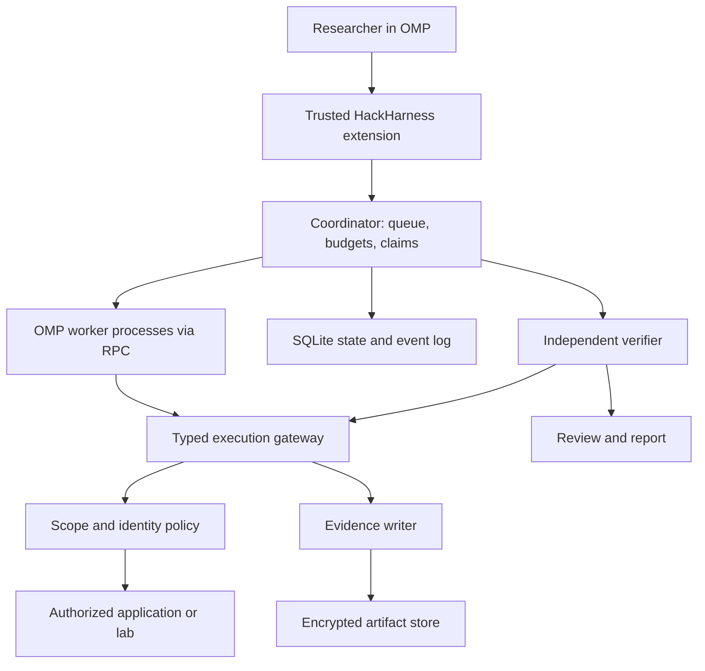

# HackHarness for Oh My Pi

Design proposal, 2026-11-03. This document specifies a system to implement; commands and interfaces below are proposed, not installed features.

## Product

A terminal-first security research workbench for owned systems, labs, and authorized bug bounty targets. Use OMP as the interactive investigator and worker runtime. Use HackHarness as the durable coordinator, execution boundary, evidence store, and verification engine.

The objective is to turn a research question into a reproducible finding with minimal repetitive work. Optimize for deep application understanding, identity and permission comparisons, useful hypotheses, and verified impact rather than scanner volume or agent count.

This is an independently designed workflow. No claim is made that it reproduces Gr3pme's, Rez0's, or Rhynorater's private tooling. Their names describe the user's intended category of expert research workflow; attributing particular techniques or architecture would require specific public sources.

## Daily use

1. Import an engagement manifest and select the permitted environment and identities.
2. Open OMP and ask: “Map this application's roles and object ownership. Prioritize authorization boundaries and cross-tenant workflows.”
3. Inspect the application map and proposed hypotheses. Steer toward interesting business flows.
4. Dispatch bounded investigations. Each worker receives a concrete question, evidence references, permitted actions, a deadline, and a request budget.
5. Read a short stream of useful changes: a new boundary, rejected hypothesis, reproducible discrepancy, or blocked prerequisite.
6. Replay promising cases with an independent verifier and export a redacted report with exact reproduction steps.

Proposed OMP commands:

```text
/hh open ./engagement.yaml
/hh map
/hh hypotheses
/hh investigate H-0042
/hh evidence F-0007
/hh replay F-0007
/hh report F-0007
/hh pause
```

The default screen shows scope, active identity labels, remaining budgets, active work, top hypotheses, and verified findings. Raw transcripts are available on demand. Never display session cookies or authorization headers in status output.

## Architecture



Implement a modular monolith first: TypeScript on Bun, SQLite with a single mutation owner, and a private filesystem artifact store. Use a separate local coordinator process so OMP sessions can restart without losing research state. Avoid distributed queues, a vector database, and a web dashboard in the first release.

### OMP adapter

The interactive TypeScript extension registers commands and tools. It calls the coordinator through a Unix socket with owner-only permissions; it does not implement policy itself. On platforms without Unix sockets, use a loopback endpoint with an ephemeral authentication token and origin checks.

Use OMP's documented `omp --mode rpc` NDJSON interface for worker isolation. The adapter owns process lifecycle, correlates request IDs, records terminal outcomes, handles abort and timeout, and treats crashes or incomplete streams as failed attempts. Never equate an RPC response acknowledging a prompt with completion: wait for the prompt's terminal result.

OMP already has a `task` tool and model roles. Reuse these for advisory, offline analysis when appropriate; use coordinator-managed worker processes for durable network investigations. All nested work must inherit the same policy and shared budgets. No agent can spawn an unaccounted worker.

Pin a tested OMP release or commit and add contract tests for command registration, tool schemas, RPC terminal results, cancellation, and nested-worker restrictions. Keep exact extension API details in the adapter; the rest of the system must not depend on unstable OMP internals.

### Execution boundary

Prompt instructions and extension hooks are usability measures, not a sandbox. Network workers run in a sandbox without direct network access, host sockets, provider secrets, or ambient project configuration. Their only target access is a typed gateway. A supervisor relays model calls without exposing model-provider credentials or a general outbound proxy to workers. Browser processes use the same controlled egress boundary, including WebSockets and subresources.

Start workers from a generated private workspace with only explicit configuration and allowlisted extensions. Do not open untrusted target repositories as OMP projects: project extensions, hooks, MCP configuration, and tools can execute code. Mount target source as read-only data. Verify the full discovery surface at the pinned OMP version; `--no-tools` or an extension allowlist alone is insufficient.

If that isolation cannot be established, offer offline analysis only. Do not label arbitrary OMP bash/browser access as scope-enforced. The human's ordinary OMP session can still use its own tools, but only gateway actions belong to the harness's enforced and audited workflow.

## Research model

Persist the following objects with stable IDs and engagement ownership:

| Object | Purpose |
| --- | --- |
| Asset | Origin, endpoint, service, repository, or local lab |
| Identity | Secret reference plus role, tenant, and allowed use |
| Observation | Factual statement linked to captured evidence |
| Hypothesis | A falsifiable claim, preconditions, proposed check, and expected control |
| Task | Role, input references, lease, attempt, budget, and outcome |
| Evidence | Immutable artifact reference, digest, capture metadata, and redaction state |
| Finding | Supported claim, impact, affected boundary, evidence, replay, and review |
| Event | Ordered, versioned record of a state transition |

Useful application maps connect identities, roles, tenants, objects, endpoints, state transitions, and trust boundaries. Begin with relational tables and explicit edges; add semantic search only if measured retrieval failures justify it.

Hypothesis states: `proposed → queued → investigating → supported | rejected | blocked | inconclusive`. Findings separately progress through `candidate → reproduced → independently_verified → reviewed → exported`, with explicit rejected and stale states. A model's confidence score never promotes a finding.

Require a baseline and a negative control where applicable. For example, an ownership hypothesis needs an owner request, a different identity request against the same controlled fixture, and evidence that the response represents unauthorized data or action. An HTTP 200 or response-size difference alone is insufficient.

## Workers and routing

| Role | Deliverable | Execution privileges |
| --- | --- | --- |
| Mapper | Application and identity graph with evidence references | Bounded approved navigation and source reading |
| Hypothesis planner | Ranked, falsifiable investigations | Read existing artifacts; no target actions |
| Investigator | Evidence for or against one claim | Task-specific gateway actions |
| Verifier | Independent replay and control comparison | Approved replay actions; separate context |
| Reviewer | Scope, impact, duplication, and report-quality assessment | Redacted evidence; no target actions |

Specialist investigation playbooks can cover authorization, session behavior, API schemas, stateful business flows, browser/server trust boundaries, and source-assisted review. Implement authorization across two controlled identities first; expand only after replay and policy are reliable.

Route mapping and extraction to a cheaper model, planning and ambiguous reasoning to a stronger model, and verification to a separate session with only the claim and necessary artifacts. A different provider is optional; independence comes from separate analysis and concrete reproduction. Models are configurable aliases, not hard-coded vendor names.

Default to two concurrent investigators per engagement and one verifier. Enforce monetary, token, request, wall-clock, and per-origin concurrency budgets centrally. Include nested calls and retries. When a provider cannot report usage, use conservative reservations and mark actual cost unknown rather than claiming an exact total.

## Scope, identities, and execution

Example proposed configuration; domain names are illustrative and intentionally do not name a live target:

```yaml
schema_version: 1
engagement: local-shop
authorization:
  reference: ./authorization.md
  expires_at: '2026-12-01T00:00:00Z'
targets:
  - origin: https://shop.lab.example
    paths: ['/api/', '/account/']
    methods: [GET, HEAD, OPTIONS]
    allowed_ports: [443]
    request_limit: 300
identities:
  - id: tenant-a-user
    secret_ref: keychain://hackharness/local-shop/tenant-a-user
    tenant: a
    role: user
  - id: tenant-b-user
    secret_ref: keychain://hackharness/local-shop/tenant-b-user
    tenant: b
    role: user
limits:
  concurrency: 2
  requests_per_second: 1
  max_cost_usd: 10
  wall_clock_minutes: 30
```

Parse and normalize URLs before checking scheme, canonical hostname, port, path, method, and resolved IP. Deny ambiguous encodings and paths. Recheck every redirect and connection; pin validated resolution and handle DNS rebinding. Block private, loopback, link-local, and metadata addresses unless the manifest explicitly declares a local lab destination. Do not grant a wildcard by substring matching. Different origins require independent declarations.

Path and method checks do not prove that an operation is harmless. Playbooks declare their effects; state-changing actions need an explicit permitted operation, controlled fixtures, cleanup rules, and a task-bound grant. Pause only when a requested operation crosses the current grant. Never infer authorization from a link discovered on a target page.

The gateway injects credentials selected by opaque identity ID. Worker-visible requests and responses redact secrets; exact sensitive captures remain encrypted and access-controlled for replay. Keep cookie jars, browser profiles, caches, and storage separate across identities and engagements. Cross-origin redirects must not forward credentials. Models never receive the secret store or raw environment.

Enforce request and byte limits, timeouts, redirect limits, concurrency, and maximum response size. An emergency pause revokes outstanding gateway grants and cancels workers. Cancellation cannot undo requests already accepted by a server; record uncertain effects for human review.

## Tool contracts

Expose a small typed surface rather than generic shell access:

```text
hh_context() -> engagement, policy summary, available identities, budgets
hh_map_query(query) -> facts with evidence references
hh_request(target_id, identity_id, request, purpose, task_id) -> redacted capture reference
hh_browser(action, identity_id, task_id) -> redacted observation references
hh_hypothesis_submit(claim, prerequisites, control, proposed_check) -> hypothesis_id
hh_task_dispatch(hypothesis_id, role, budget) -> task_id
hh_evidence_read(evidence_id, view) -> authorized redacted artifact
hh_finding_submit(claim, evidence_ids, replay_spec) -> candidate_id
hh_replay(candidate_id) -> verification_attempt_id
```

Validate all arguments, engagement ownership, active task leases, and grants server-side. Agents cannot create policy grants, assert a verified state, mutate evidence, or raise their own budgets. Treat target content and imported evidence as untrusted input, including instructions embedded in HTML or source comments.

## Evidence and replay

Every capture records engagement, task and attempt IDs, identity label, UTC time, policy version, request metadata, response metadata, redacted representation, sensitive-artifact reference, and content digest. Record tool and OMP versions, model alias, and relevant execution configuration. Hashes detect corruption; hash chains alone do not prove authenticity against a host administrator. Add signing or an external audit sink only when that threat model requires it.

Replay specifications contain fixture setup, secret references, typed request templates, volatile-field extraction, expected control behavior, assertions for the claimed impact, cleanup, and limits. Never blindly replay writes against a production account. Expired credentials, missing fixtures, or a changed target yield `blocked` or `stale`, not `passed`.

Verification is deterministic where possible: assert ownership, protected fields, state changes, and control outcomes. Record nondeterminism and manual prerequisites explicitly. A reviewer checks impact and duplicates after reproduction; LLM agreement alone does not establish a vulnerability.

Exports include scope and affected versions, preconditions, redacted requests and responses, exact reproduction steps, observed impact, limitations, and evidence IDs. Draft reports require a human decision before submission to an external program. No automated disclosure or external messages.

## Reliability and privacy

The coordinator commits state transitions and their events in one transaction. It leases tasks with heartbeats and attempt IDs, deduplicates work by hypothesis and normalized action, and resumes unfinished analysis after restart. Replay external writes only with explicit idempotency or human review; exactly-once target effects are not promised.

Store operational logs separately from sensitive artifacts. Apply restrictive permissions and redaction before model access. Keep encryption keys outside the database and artifacts. Configure engagement retention; deletion must cover originals, derived artifacts, search indexes, and exports under harness control. Hash references may remain as audit metadata only under the chosen retention policy.

## Proposed repository layout

```text
packages/core/          policy, schemas, queue, state transitions
packages/coordinator/  local API, scheduler, evidence writer
packages/omp-adapter/  extension, RPC lifecycle, protocol contracts
packages/gateway/      HTTP/browser execution and identity injection
packages/replay/       fixture lifecycle and assertions
playbooks/             versioned investigation procedures
examples/              lab manifests and redacted reports
tests/fixtures/        local multi-tenant application
tests/acceptance/      policy, crash recovery, end-to-end replay
```

Keep engagement data outside the repository, for example under an owner-only application-data directory. Never commit cookies, session exports, live target captures, or provider credentials.

## Implementation sequence and acceptance criteria

1. **One complete local workflow.** Build the coordinator, manifest validation, identity-isolated HTTP gateway, evidence store, and OMP adapter. Against a local fixture, map endpoints, investigate one ownership hypothesis, reproduce it using controls, and export a redacted report. Demonstrate that the same procedure rejects the fixed fixture. No real-target automation in this milestone.
2. **Reliable parallel research.** Add bounded workers, model routing, leases, task deduplication, budgets, cancellation, and restart recovery. Kill a worker and coordinator during a run; recover evidence without silently repeating a state-changing action. Prove child work shares budgets.
3. **Stateful browser work.** Add isolated browser identities and controlled egress. Test redirects, subresources, WebSockets, DNS rebinding, cookie leakage, prompt injection, and malicious project configuration. Browser automation remains unavailable until these boundaries pass.
4. **Research quality.** Add source-assisted playbooks, richer application maps, reviewer workflow, and benchmark reporting. Benchmark labeled vulnerable and fixed local fixtures; split fixtures for tuning and evaluation. Measure verified precision, missed seeded defects, duplicate rate, requests per verified finding, cost, time, replay success, and scope violations. Report denominators and incomplete runs.

Release gates: all policy escape tests pass; vulnerable and fixed fixture outcomes are correct; exported artifacts contain no seeded secrets; restart recovery preserves state; OMP RPC cancellation and completion contracts pass at the pinned version. No numerical accuracy claim until a benchmark has actually run.

## Implementation status (updated 2026-11-04)

Milestones 1, 2, and the read-only part of 4 are implemented and tested (details and exact tool/flag list in the README):

- **Milestone 1, complete.** Manifest validation with per-target budgets, the identity-isolated scoped gateway (DNS pinning, redirect revalidation, redaction-before-evidence), SQLite state with events, the OMP adapter, and the authorization playbook end to end: map → hypothesis → investigate → fenced replay → review → exported report; the fixed fixture reproduces the rejection.
- **Milestone 2, complete.** Task leases with attempt IDs, wall-clock deadlines, action-key deduplication, heartbeats with stale-only recovery after kills, restart recovery, engagement-wide concurrency caps, cost reservations (atomic per-dispatch, retention on unreported usage), and OMP worker dispatch over `omp --mode rpc` for investigation (`hh delegate`), independent verification (`hh verify`), review (`hh assess`, role-gated tool allowlist so the reviewer process lacks target-facing tools), and a wave-scheduled autopilot. Mid-run kills are recovered without repeating work.
- **Milestone 3, initial boundary only.** `hh proxy` is a fail-closed HTTP egress boundary with per-identity host-only cookie jars (Domain-widened cookies dropped, RFC path matching, Secure/https gating). Real browser automation, TLS/CONNECT interception, WebSocket/subresource handling, and the redirect/DNS-rebinding/prompt-injection test battery remain unavailable until they can run against an actual browser.
- **Milestone 4, first parts.** `hh map` records evidence-cited observations; `hh sources`/`hh source-read` expose read-only source hints with traversal/digest guards; `hh assess` is the reviewer workflow; `hh bench` (direct playbook) and `hh bench --workers` (planner-led) report labeled-fixture metrics with explicit denominators, including cost and unreported-run counts.

Release gates pass to date: scope-escape and budget tests, positive/negative fixture outcomes, no seeded secrets in artifacts, restart recovery, and RPC completion/cancellation contracts verified against installed OMP 18.15.0 (RPC protocol v1 wire contract in `tests/worker.test.js`; opt-in live checks via `HH_OMP_TEST=1`). Model-driven accuracy numbers remain future work until a full benchmark campaign runs.

## OMP sources and compatibility

Public upstream README consulted on 2026-11-03:

- [OMP repository and installation](https://github.com/can1357/oh-my-pi)
- [Entry points, SDK, and RPC](https://github.com/can1357/oh-my-pi#four-entry-points-interactive-one-shot-rpc-and-acp)
- [Extension primitives and project trust](https://github.com/can1357/oh-my-pi#a-harness-worth-keeping-is-one-you-dont-outgrow)

Upstream HEAD observed during research: `83de60ad992d12e572ec3ed6fe2dd9e160cdc4a2`. The README was retrieved from `main`, so that HEAD is a nearby observation rather than proof the retrieved document belongs to that exact commit. Pin and inspect an immutable release before implementing; extension symbols and CLI switches remain compatibility work until contract-tested. OMP was not installed or executed for this design.
